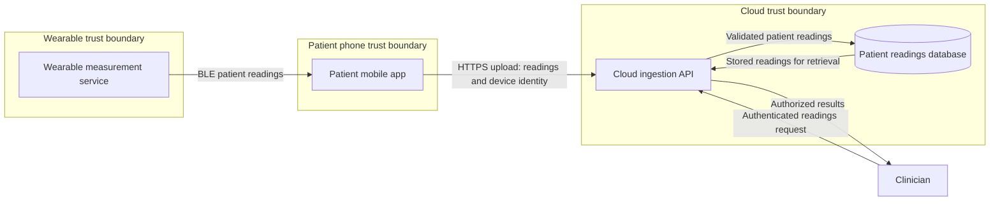

# Medical-device threat modeling exercise

A practical, fictional wearable → mobile → cloud security study using Microsoft Threat Modeling Tool and STRIDE. This repository shows how to move from a data-flow diagram to specific threats, proposed controls and verification criteria—and why generated findings require human review.

**Scope:** patient readings, storage and clinician review. No remote therapy commands. This is independent educational work, not an assessment of a real product, clinical safety validation, regulatory submission or endorsement by any manufacturer or referenced organization. No implementation or security tests were performed.

## System at a glance

Flow labels describe intended behavior, not proven security properties. Identity provider, clinician portal, enrollment, key provisioning, updates and detailed endpoint storage are omitted and require later modeling.

## Results

- **41 generated findings:** reviewed individually; template priorities are not clinical risk scores.
- **Three additional scenarios:** cross-patient upload authorization, replay/stale readings, and upload resource exhaustion.
- **44 model records total:** the three added scenarios remain `NeedsInvestigation`; planned controls are not verified mitigations.
- **Evidence plan:** positive and negative cases, expected outcomes, owner roles and unresolved assumptions.

| Scenario | Proposed control direction | Example verification criterion |
| --- | --- | --- |
| T-01: valid caller submits another patient's device ID | Server-side caller/device/patient authorization | A's identity cannot modify B's records; legitimate access works |
| T-02: replayed or delayed readings appear current | Provenance, freshness, sequencing and explicit offline rules | Replays do not create fresh duplicates; legitimate delayed uploads follow defined rules |
| T-03: uploads exhaust resources | Bounded work, quotas, backpressure and recovery | Isolated load testing measures legitimate traffic and recovery against agreed budgets |

## Explore the artifacts

1. [Exercise walkthrough](WALKTHROUGH.md): reproduce the modeling process.
2. [Threat worksheet](THREAT-WORKSHEET.md): STRIDE and three complete threat/control/test chains.
3. [Review ledger](EXERCISE-REVIEW.md): all generated findings, applicability decisions and limitations.
4. [Editable Microsoft model](AMPS-Practice.tm7): open in Microsoft Threat Modeling Tool.
5. [Baseline generated findings](AMPS-Generated-Threats.csv): original automated output, before the three custom records.
6. [Artifact verification summary](exercise-verification.json): recorded model counts/statuses; not security-test evidence.

## Open the model

Install [Microsoft Threat Modeling Tool](https://learn.microsoft.com/en-us/azure/security/develop/threat-modeling-tool-getting-started), download or clone this repository, and open `AMPS-Practice.tm7`. Inspect both Design and Analysis views. Generic element properties are largely unassessed defaults; do not interpret them as discovered implementation facts. Compatibility with every tool version has not been established.

For a new model, obtain the community medical-device template from the upstream link in [attribution](THIRD-PARTY-NOTICES.md). The downloadable playbook and standalone templates are linked rather than bundled. The saved model embeds template material and includes its license notice here.

## What this demonstrates

Architecture decomposition; trust-boundary reasoning; STRIDE; object-level authorization; provenance and freshness; availability constraints; human triage of automated prompts; and traceability from threat to proposed requirement and test. Cybersecurity consequences and clinical severity must be evaluated with appropriate engineering and clinical partners.

Next iterations: enrollment and identity-provider flows, clinician sessions, device key lifecycle, signed updates and recovery, offline states, then implementation-backed verification.

## References and attribution

- [MITRE/MDIC Medical Device Threat Modeling Playbook (2021)](https://mdic.org/wp-content/uploads/2021/11/Playbook-for-Threat-Modeling-Medical-Devices.pdf): fictional AMPS inspiration, simplified here rather than reproduced as a complete model.
- [OWASP threat modeling](https://owasp.org/www-community/Threat_Modeling).
- [OWASP API1: Broken Object Level Authorization](https://api-security.owasp.org/editions/2023/en/0xa1-broken-object-level-authorization/).
- [FDA medical-device cybersecurity guidance](https://www.fda.gov/regulatory-information/search-fda-guidance-documents/cybersecurity-medical-devices-quality-management-system-considerations-and-content-premarket): consult the original for regulatory expectations.
- [MITRE EMB3D](https://emb3d.mitre.org/): possible embedded-device extension.

Prepared with AI assistance and Microsoft Threat Modeling Tool. The documented review is an educational first pass, not an independent clinical or regulatory review. See [third-party notices](THIRD-PARTY-NOTICES.md). No blanket license is asserted over third-party content or the author's original additions; upstream rights remain with their owners.

